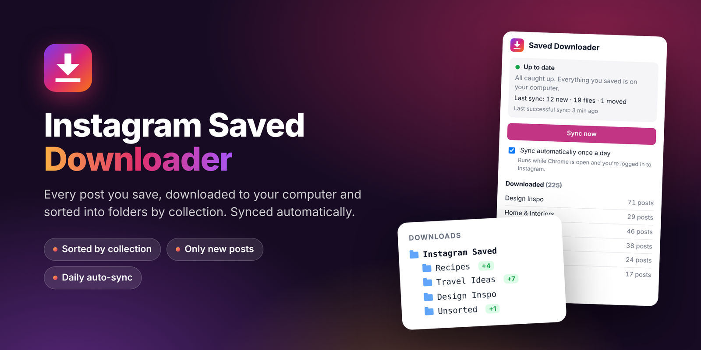
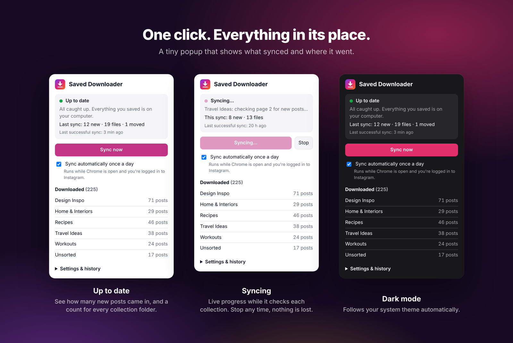
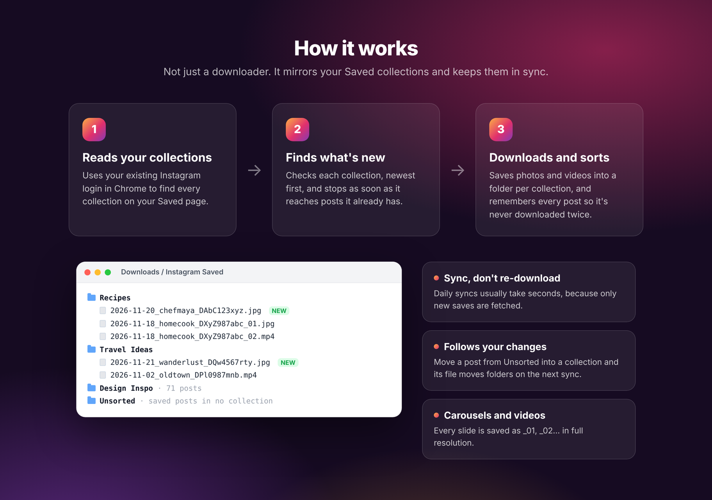

<p align="center">
  
</p>

<h1 align="center">Instagram Saved Downloader</h1>

<p align="center">
  <b>Your saved Instagram posts, on your computer, sorted by collection, and kept in sync.</b><br>
  A free, open-source Chrome extension. No servers, no sign-ups, no tracking.
</p>

<p align="center">
  
  
  
  
</p>

<p align="center">
  <a href="#-install-in-1-minute">Install</a> ·
  <a href="#-how-it-works">How it works</a> ·
  <a href="#-features">Features</a> ·
  <a href="#-faq">FAQ</a>
</p>

---

## ✨ What it does

You save posts on Instagram all the time: recipes, travel spots, design ideas, workouts. They live inside the app, and if a post gets deleted or your account has a problem, they're gone.

**Instagram Saved Downloader** copies every saved photo and video to your computer and **mirrors your Saved collections as folders**. After the first run it only fetches what's new, so you can let it **sync once a day** in the background and forget about it.


## 📸 Screenshots

<p align="center">
  
</p>

<sub>Screenshots show sample data.</sub>

## 🧠 How it works

<p align="center">
  
</p>

1. **Reads your collections.** It uses the Instagram login you already have in Chrome. Your password never touches the extension.
2. **Finds what's new.** Instagram lists saved posts newest first, so each sync stops as soon as it reaches posts it already has. A daily sync usually takes a few seconds.
3. **Downloads and sorts.** Each post goes into the folder for its collection, named by date, account and post ID. Every downloaded post is remembered, so nothing is ever downloaded twice.

## 🚀 Features

| | |
| --- | --- |
| 🗂️ **Sorted by collection** | One folder per Saved collection, plus an `Unsorted` folder for everything else. |
| 🔁 **Real sync, not a re-download** | Remembers every post it has saved. Each sync only fetches new posts. |
| ⏰ **Daily auto-sync** | Tick one box and it syncs about once a day while Chrome is open. Missed a day? It catches up on the next launch. |
| 🧭 **Follows your changes** | Move a post from Unsorted into a collection and its file moves folders on the next sync. |
| 🎞️ **Photos, videos and carousels** | Highest resolution available. Every carousel slide is saved. |
| 🛑 **Stop any time** | Progress is saved. The next sync picks up where it left off. |
| 🐢 **Gentle on Instagram** | Requests are spaced 1.5 to 3.5 seconds apart, and it backs off automatically if Instagram asks it to slow down. |
| 💾 **Backup and restore** | Export your download history to a file, and import it after a reinstall so nothing is fetched twice. |
| 🌙 **Dark mode** | Follows your system theme. |
| 🔒 **Private by design** | Runs entirely in your browser. Talks only to instagram.com. No analytics, no servers. |

## 📦 Install in 1 minute

> Not on the Chrome Web Store yet, so you install it in Developer mode. It only takes a minute.

1. **Download** this repo: click the green **Code** button → **Download ZIP**, then unzip it.
2. Open **`chrome://extensions`** in Chrome.
3. Turn on **Developer mode** (top right).
4. Click **Load unpacked** and choose the unzipped folder (the one that contains `manifest.json`).
5. **Pin it:** click the puzzle-piece icon in the toolbar, then the pin next to *Instagram Saved Downloader*.
6. Make sure you're **logged in to instagram.com** in the same Chrome profile.

Built for Chrome. Other Chromium browsers (Edge, Brave, Arc) should work too.

## 🕹️ Usage

1. Click the extension icon → **Sync now**.
2. A small Instagram window opens for a few seconds to read your collection list, then closes by itself.
3. Downloads run in a hidden background tab. Watch the progress in the popup.
4. Turn on **Sync automatically once a day** and you're done.

The icon badge shows how many new posts the last sync downloaded, or `!` if something needs your attention.

### Settings & history

Open **Settings & history** at the bottom of the popup:

| Option | What it does |
| --- | --- |
| **Instagram username** | Detected automatically. Only fill it in if detection fails. |
| **Folder inside Downloads** | Rename `Instagram Saved` to anything you like. Chrome only lets extensions save inside your Downloads folder. |
| **Full re-check** | Reads every page of every collection instead of stopping early. Already-downloaded posts are still skipped. |
| **Export history** | Saves the list of downloaded posts to a JSON file. |
| **Import history** | Loads that file back in, for example after reinstalling. |
| **Reset history** | Forgets everything, so the next sync downloads all posts again. Existing files are overwritten, not duplicated. |

> **Tip:** removing the extension deletes its history. Use **Export history** now and then to keep a backup.

## ❓ FAQ

<details>
<summary><b>Why does a small Instagram window pop up?</b></summary>

Instagram only shows the collection list in a tab you can actually see. The extension opens a small window, scrolls your Saved page, and closes it after a few seconds. The list is remembered, so the window only comes back when you've made a new collection, once a week as a refresh, or when you press **Full re-check**.
</details>

<details>
<summary><b>A post is in two collections. Where does it go?</b></summary>

It's saved once, in the first collection Instagram lists for it (the order on your Saved screen at the time of the sync).
</details>

<details>
<summary><b>Chrome asks me where to save every file.</b></summary>

Turn off *Settings → Downloads → Ask where to save each file before downloading*.
</details>

<details>
<summary><b>The first sync is slow.</b></summary>

That's on purpose. Requests are paced to stay gentle on Instagram, so a big library takes a while the first time. Press **Stop** whenever you like. Progress is kept, and daily syncs after that take seconds.
</details>

<details>
<summary><b>Syncs suddenly fail with errors.</b></summary>

Check you're still logged in to instagram.com. If you are, Instagram may have changed its internal web API. Please <a href="../../issues">open an issue</a>.
</details>

<details>
<summary><b>What about captions and comments?</b></summary>

Only photos and videos are downloaded for now.
</details>

## 🛠️ Under the hood

```
manifest.json          Extension config (Manifest V3)
background.js          Sync engine: collection reading, paging, download tracking, daily schedule
popup.html             Popup layout
popup.css              Popup styles, light and dark
popup.js               Popup logic
icon16/32/48/128.png   Extension icons
banner.png, screenshots.png, how-it-works.png   README images
```

- Uses the same internal web API that instagram.com itself uses, called from an instagram.com tab so it runs on your existing session.
- Each downloaded post is stored in `chrome.storage.local` under its Instagram ID. That record is what makes syncing possible.
- An hourly `chrome.alarms` check starts a sync once about a day has passed. If Chrome was closed, it catches up on the next launch.
- Failed downloads are retried on the next sync.

## 🤝 Contributing

Ideas, bug reports and pull requests are welcome. Open an issue to start a conversation.

## ⚠️ Disclaimer

This project is not affiliated with, endorsed by, or connected to Instagram or Meta. Automated downloading is against Instagram's Terms of Use. The extension paces its requests to keep the risk low, but it isn't zero, so use it at your own risk. Only download content you have the right to keep, and respect the creators of the posts you save.

## 📄 License

[MIT](LICENSE). Free for anyone to use, copy, modify and share.
